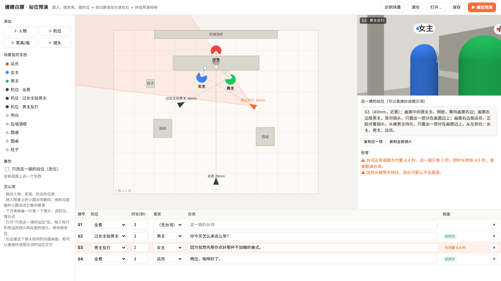

# 娜娜白膜 · 站位预演（nana-whitebox）

给 AI 视频做"白膜预演"的网页小工具。打开网页就能用，不用装任何东西。

**在线使用：** https://nawusijia.github.io/nana-whitebox/



## 它解决什么问题

多人对话戏交给 AI 视频模型时，最容易出错的不是模型，而是写提示词的人（或者帮你写提示词的 AI）：谁在画面左边、谁在右边写反了，正反打一切机位就越轴，人物突然换了位置。

这个工具让你先在俯视图上把人、家具、机位摆好，然后：

1. **自动算站位**：每个镜头里谁在画面左边、谁在右边、谁背对镜头、谁被什么挡住、谁根本不在画面里。这段文字可以直接复制进提示词。
2. **检查越轴**：相邻两个镜头里，同一对人物的左右关系反了，会标出来。
3. **检查台词说不说得完**：按正常语速估算每句台词要几秒，镜头时长不够会标橙色。
4. **出白膜画面**：每个机位拍到的灰色白膜画面，人物用胶囊表示，白色面罩是脸朝的方向。
5. **播放预演**：每个镜头一张图，按时长拼成一条预演，浏览器会把台词念出来，可以顺便录成视频。

## 怎么用

1. 点「示例场景」看一遍：咖啡店里三个人，四个镜头。
2. 「＋ 人物」「＋ 家具/墙」「＋ 机位」往场景里加东西，在俯视图上拖动它们。
   - 拖人物身上的小圆点，改他脸朝哪边。
   - 拖机位前面的小圆点，改镜头看向哪里。左边属性栏可以改焦距和高度。
3. 「＋ 镜头」加一个镜头，在下方表格里选机位、填时长、选谁说、填台词。
4. 想做走位：选中某个镜头，勾上「只改这一镜的站位」，再拖人物。这个镜头和它后面的镜头都会用新位置。
5. 右边就是这个镜头的白膜画面和站位文字，点「复制这一镜」或「复制全部镜头」粘进你的提示词。
6. 「保存」会下载一个 .json 文件，下次用「打开…」读回来。浏览器也会自动记住上次的场景。

## 小经验（来自我们的对照实验）

- 白膜不用做精细，方块级就够：体积和遮挡要准，细节可以糙。
- 原地转、正反打这类镜头，把左右写清楚，文字就够了，不一定要上视频白膜。
- 空间要连起来的时候（比如楼梯接二楼），视频白膜才真正有用。
- 白膜里的人用大胶囊，按真人速度走，起步停下要慢；白膜拍得不好，模型会照着学。
- 这个工具输出的白膜图，是给**写提示词的人**看的，用来想清楚站位，不用挂给视频模型当参考图。

## 本地运行

下载整个仓库，在仓库目录里启动任意一个静态服务器，比如：

```bash
python -m http.server 8000
```

然后浏览器打开 http://localhost:8000 。直接双击 index.html 也能打开，但部分浏览器会拦截本地模块，建议用静态服务器。

## 说明

- 3D 部分用的是 [three.js](https://threejs.org)（MIT），已经放在 `vendor/` 里，不依赖外网。
- 台词估时按中文每秒约 4.5 个字计算；「播放预演」里的朗读用的是浏览器自带语音，不同浏览器声音不一样。
- 录制出来的视频是 .webm 格式，不带朗读声音。

由 娜乌斯嘉AI 和 克肆（Claude）一起做的。MIT 协议，随便用。
